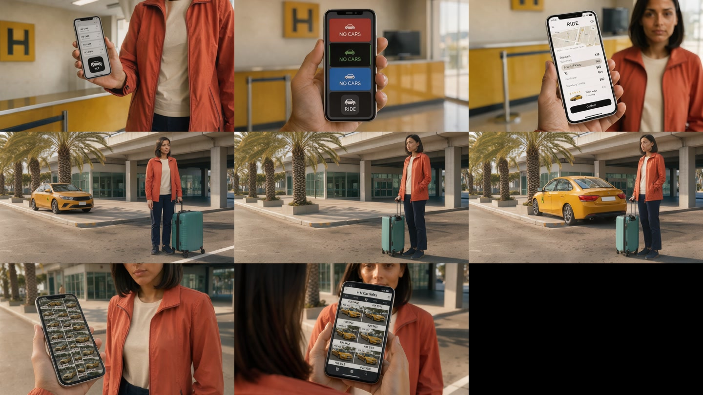
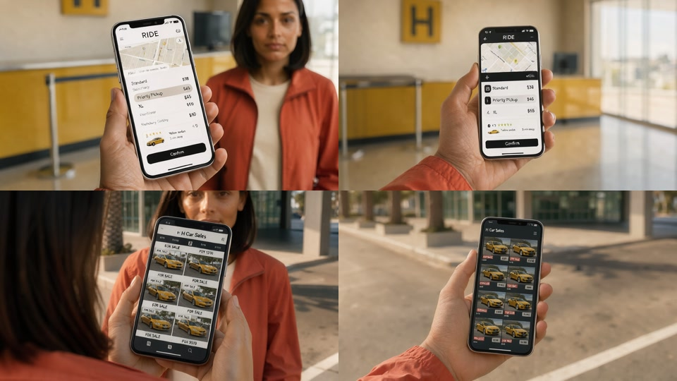

# Review round 1 · Human feedback on v0

*23 Nov 2026, after step 3 (voices), before the final pass*

## What the reviewer asked for

The reviewer went through the v0 review page shot by shot. Notes in English; the original words are kept in the
story file.

| Shot | Note | Kind of fix |
|---|---|---|
| e1s03 | Remove the extra woman. (Self-check had already caught it in step 3; the table must say so.) | regenerate (final pass) |
| e1s04 | The draft clip ends with an odd smile, but that can be cut in the edit. | post |
| e1s06 | Make the line ask for any car at all: with no cars left, she has to ask for another option. | line |
| e1s07 | "Both are gone" should apologise: neither is possible, they're all gone. | line |
| e1s08 | Redraw the phone: other platforms in red, black with green and blue, all NO CARS. Just the zoomed-in hand. | image |
| e1s08b | New: a ride-hailing screen with Uber-like branding, a tier (Priority Pickup and others) with prices, and a driver. | new shot |
| e1s09 | No car in the first frame: she is waiting for it, so the space reads wrong. To go in the manual table. | image |
| e1s13, e1s14 | Swap them: the odometer insert comes after the Driver's line. | order |
| e1s15 | A phone close-up and her voice: "Oh true, H sells lots of cars on H Car Sales." | image and line |
| e1s19 | No seat behind the Driver in the frame, but cropping can hide it. | post |

## What changed

- **Story v1:** 21 shots (e1s08b is new), 119 s of clips instead of 112. Two lines rewritten, e1s06 ("Then upgrade me,
  or downgrade me to whatever car you have.", 4 → 5 s) and e1s07 ("I'm sorry, neither is possible. They're all gone.
  If you wait two hours, you may get compensation.", 6 → 7 s). e1s15 gains a line ("Oh, true. H sells lots of its
  cars on H Car Sales.", 4 → 5 s). e1s14 now plays before e1s13. e1s04 and e1s19 carry a note for the edit.
- **Frames:** e1s08, e1s08b, e1s09 (first and last) and e1s15 redrawn.
- **Code:** a last frame can take reference sheets of its own (`last_refs`), so a car that pulls up into a lane that
  was empty is drawn from the sedan's sheet instead of from memory.
- **Review log:** every shot and reference sheet now carries a `review` list: who found the issue, the reviewer's
  note, the fix, whether it can be fixed in post, and its status. The review page is built from it.

## Self-check during the round

- e1s08b's first draw showed her face sharp beside the phone and two extra rows of garbled prices.
- e1s15's first draw read as two people: the back of a head in front, her face behind the phone.

Both were redrawn as point-of-view shots looking down at the phone, with only her hand and the coral cuff in frame.

## Cost

Six redraws, about $0.17 by the account balance.

## Thinking at this point

- A reviewer sees what self-check does not: whether a line makes sense, whether the space reads right, and which
  flaws are cheap to fix in the edit. Recording who found each item makes that split visible.
- Post-production counts as a fix. Two of the ten items, an odd smile at the end of a clip and a missing seat, cost
  nothing in the edit and should not cost a regeneration.
- Phone screens work better as point-of-view shots: there is no face to keep consistent, and the text gets the frame.
