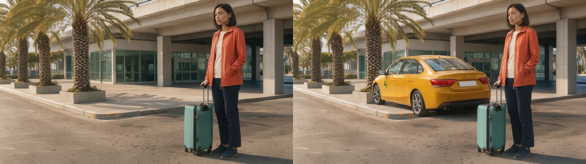
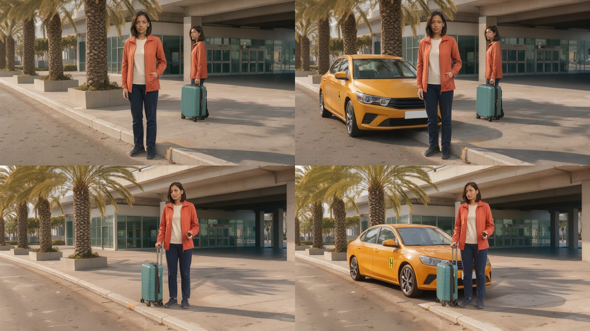

# Review round 2 · e1s09, again

*23 Nov 2026, before the final pass*

## What the reviewer found

> The car in the last frame still isn't on the road. Still wrong.

## Why it was wrong

In the v1 first frame Traveler stood on the asphalt lane, with the sidewalk and its planters behind her. Asked to
bring the sedan into "the lane in front of her", the last frame could only park it on the sidewalk. The person and
the car had swapped places.

Self-check had confirmed what the round-1 note asked for, an empty lane and a car that arrives, but not which surface
each of them stood on. This is the one item so far that self-check missed; review_v2 marks it "No, missed".

## The fix

Both frames redrawn with the episode's original blocking:

- the camera on the sidewalk at shoulder height, angled toward the pickup lane;
- Traveler on the sidewalk at the curb, her hand on the suitcase handle beside her;
- the sedan arrives along the asphalt lane and stops alongside the curb in front of her, all four wheels on the road.

Self-check caught a new problem on the way: the first v2 draw had two Travelers, one at the curb and a copy with the
suitcase behind her, and the copy carried into the last frame. "Exactly one person in the whole frame" fixed it.

## The review page

[reviews/review_v2.html](../reviews/review_v2.html) is English only, compares v2 with v1, and adds a column: did
self-check catch it? At this point: 12 items found by self-check, 11 by the reviewer, 1 missed by self-check.
`review.py` builds it from the story's review lists, against a snapshot folder or a commit.

## Cost

Four redraws, about $0.09. Round 1 and round 2 together: $0.26 by the account balance, which stands at $4.60 of
$6.00 before the final pass.

## Thinking at this point

- Spatial relations need their own check. For every shot with people and vehicles: who stands on what, sidewalk or
  road, which side of the counter, and where each will be by the last frame.
- A last frame inherits everything in its first frame, mistakes included. Fix the first frame, then redraw the last.
- Next: the final pass, 21 clips at 768p on Radical Speed, about $3.57 by the price list.
