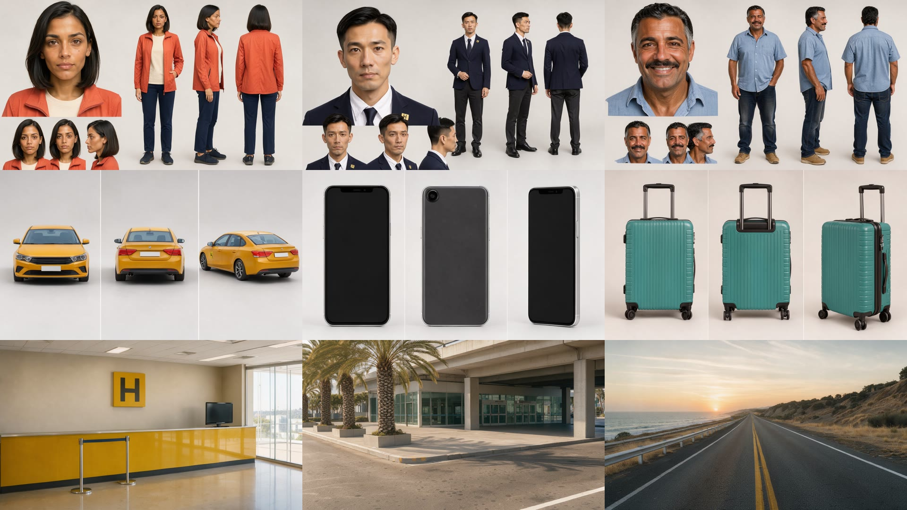

# Step 1 · Reference sheets / 第 1 步 · 资产设定图

*23 Nov 2026 · The Rental Booking Paradox, episode 1*

## English

**What ran.** Nine reference sheets with FLUX 3 Image Klein (`nunchux-flux.3-image-klein`, Radical Speed tier):
three character turnarounds and three prop three-views at 1536×864, and three empty location plates at 1280×720.
The prompts come from the episode's own character, prop and scene descriptions; the only addition was a prompt for
the teal suitcase, which had a description but no prompt.

**Speed.** Eight of the nine calls took 0.8–2.1 s. The counter plate took 75.7 s, still unexplained. With four
requests at a time the batch took 78 s. Every re-roll came back in 1–2 s.

**Cost.** 13 generations with the re-rolls: $0.022 by the account balance ($6.000 → $5.978). Text to image came to
about $0.0014 per megapixel, a fifth of the first estimate.

**What was re-rolled, and why.**

| Sheet | What was wrong | What the description now says |
|---|---|---|
| Traveler | looked 35 or older; the brief says mid-twenties | "she looks about 25, with a youthful face" |
| Yellow H sedan | a Hyundai-like emblem on the grille, no faded roof | a plain grille and trunk lid with no emblem; the faded roof "clearly visible in the three-quarter view" |
| Yellow H sedan, again | the three-quarter view turned into a hatchback | "the same three-box four-door sedan body with a separate trunk in all three panels, never a hatchback" |
| Airport curb | garbled lettering above the entrance | "no signs or lettering above them" |

Kept as first drawn: Clerk (his H lapel pin came out right), Driver, the phone, the suitcase, the counter and the
coastal highway. Before and after: [Traveler, sedan, curb](img/step1-reroll.jpg) ·
[the sedan's second try](img/step1-sedan-reroll.jpg). Earlier attempts stay on disk as `name.a0.jpg`, `name.a1.jpg`.

**Thinking at this point.**
- Consistency starts at the sheets. Whatever is wrong here repeats in all 20 shots, so this is the step to be strict.
- A brand-like mark has to go now, before it multiplies.
- Image calls are cheap and fast enough that re-rolling is the default, not a decision.
- A small generic badge is left on the sedan's trunk lid; it does not read as any real brand.
- The price list overestimated images; the real cost will sit in video, so that is where the budget goes.

## 中文

**跑了什么。** 用 FLUX 3 Image Klein（`nunchux-flux.3-image-klein`，Radical Speed 档）生成 9 张参考图：
3 张人物多视图设定、3 张道具三视图（1536×864），3 张无人场景空镜（1280×720）。提示词来自这一集原有的人物、
道具和场景描述；只给青绿色行李箱补写了一段提示词，原来只有描述，没有提示词。

**速度。** 9 次调用里 8 次在 0.8–2.1 秒之间；柜台空镜那次用了 75.7 秒，原因还没查明。4 路并发，整批 78 秒。
每次重抽都在 1–2 秒内返回。

**花费。** 含重抽共 13 次生成，按账户余额实际扣 $0.022（$6.000 → $5.978）。文字生图约每百万像素 $0.0014，
只有最初估算的五分之一。

**重抽了什么，为什么。**

| 设定图 | 问题 | 描述改成 |
|---|---|---|
| Traveler | 看着 35 岁往上，设定是二十五六岁 | 加上"看起来 25 岁左右，脸显年轻" |
| 黄色 H 轿车 | 车头格栅上有个像 Hyundai 的车标，车顶没有褪色 | 车头和后备箱盖都不要标；褪色车顶"在斜 45 度视图里清楚可见" |
| 黄色 H 轿车，第二次 | 斜 45 度那格变成了两厢掀背车 | "三格都是同一款带独立后备箱的四门三厢车，绝不是两厢车" |
| 机场路边 | 入口上方有一行乱码招牌字 | "入口上方没有招牌和文字" |

原样保留：柜员（领口的 H 徽章画对了）、司机、手机、行李箱、柜台、海岸公路。前后对比：
[Traveler、车、路边](img/step1-reroll.jpg) · [车的第二次](img/step1-sedan-reroll.jpg)。
旧版本留在本地，文件名带 `.a0`、`.a1`。

**当时的想法。**
- 一致性从设定图开始。这里错了，20 个镜头都会跟着错，所以这一步要最严。
- 像品牌的标志必须在这一步去掉，不然会被复制到每个镜头里。
- 生图又便宜又快，重抽是默认动作，不需要犹豫。
- 车的后备箱盖上留了一个很小的通用小标，看不出是哪个真实品牌，先保留。
- 价格页把图片估贵了，真正的钱会花在视频上，预算要留给视频。
