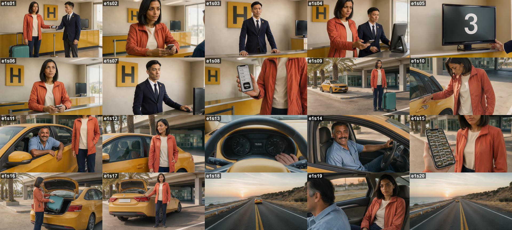

# Step 2 · First and last frames / 第 2 步 · 首帧与末帧

*23 Nov 2026 · The Rental Booking Paradox, episode 1*

## English

**What ran.** 20 first frames and 2 last frames with FLUX 3 Klein Edit (`nunchux-flux.3-image-klein-edit`,
Radical Speed tier, 1280×720). Each frame was composed from the reference sheets its shot uses (one to five of them),
named in order in the prompt: "Traveler is the person in Image 1 … The setting is the place in Image 4". The two
last frames were drawn from their own first frame with one change each.

**Speed.** The 22 frames took 29 s with four requests at a time; per call the median was 4.7 s and the longest 7.3 s.
The four re-rolls took 6 s, the last one 3 s.

**Cost.** Step 2 took $0.58 by the account balance ($5.978 → $5.400), about four times the first estimate. An edit
is billed on the output and every reference image together, about $0.006 per megapixel on Radical Speed, and a
shot with four or five 1.3 MP sheets carries most of its cost in its inputs. The cost model now counts inputs, the
receipts were repriced and marked, and they come to $0.68 against $0.60 measured for both steps.

**Consistency.** The three people hold across the 20 frames: same face, hair and outfit, the Clerk's H pin in every
frame he is in, the teal suitcase and the sun-faded yellow sedan where they belong.

**What was re-rolled, and why.** The first pass is in [the text check](img/step2-text-check.jpg) and
[the first last frames](img/step2-first-attempt-lastframes.jpg).

| Shot | What was wrong | What the description now says |
|---|---|---|
| e1s05 | the H sign behind the Clerk came out as half an H; a medium shot instead of an insert | a tight insert of the monitor screen and his sleeve, "no sign, wall or lettering in view" |
| e1s08 | the RIDE icon, the beat that sends her outside, was missing | "one large near-black square app icon with a white car symbol and the word RIDE under it" at the bottom of the screen |
| e1s13 | a Ford-like oval emblem on the steering wheel; the odometer was gibberish | a digital odometer display "shows 70,000 in large, clear digits"; "the steering wheel hub is plain" |
| e1s13, again | the wheel rim hid half the number | the cluster "seen through the open upper gap of the steering wheel", the display "fully visible" |

After: [e1s05 first and last frame, e1s08, the second e1s13](img/step2-reroll.jpg) ·
[the e1s13 that was kept](img/step2-e1s13-final.jpg) (it reads 70.000, with a dot).

**Text check.** CONFIRMED, NO CARS, RIDE, 3 then 0, 70.000 and FOR SALE all render. The two last frames worked:
the monitor goes from 3 to 0, and the sedan pulls up and stops in front of her.

**Thinking at this point.**
- Text inserts need the words named and the framing tight. Writing "insert close-up" as the shot size is not enough;
  the model frames wider until the frame description itself says what fills it.
- Every brand-like mark found so far sat on a car (grille, trunk, steering wheel). Cars need "no emblem" in every
  description that shows one.
- Images are not where the money goes, but they are where the estimate was wrong. The balance, not the price list,
  is the record from here on.
- Next is step 3: one draft clip per voice, to hear whether a voice holds and whether the narrator stays off screen
  before rendering everything.

## 中文

**跑了什么。** 用 FLUX 3 Klein Edit（`nunchux-flux.3-image-klein-edit`，Radical Speed 档，1280×720）生成
20 张首帧和 2 张末帧。每张首帧都用该镜头涉及的设定图来合成（1 到 5 张），在提示词里按顺序点名：
"Traveler 是 Image 1 里的人……场景是 Image 4 里的地方"。两张末帧都是在各自首帧的基础上只改一处。

**速度。** 4 路并发，22 张 29 秒出完；单次调用中位 4.7 秒，最长 7.3 秒。4 次重抽一共 6 秒，最后一次 3 秒。

**花费。** 按账户余额，第 2 步实际花了 $0.58（$5.978 → $5.400），约为最初估算的 4 倍。改图接口按输出图加所有
参考图的总像素计费，快档约每百万像素 $0.006；一个镜头带 4–5 张 1.3 百万像素的设定图，钱主要花在输入上。
计费公式已改成把输入算进去，旧收据按新公式重算并做了标记，两步合计估算 $0.68，实际扣费 $0.60。

**一致性。** 三个人在 20 张图里都对得上：同一张脸、同样的发型和衣服；柜员出现的每一格都有 H 胸章；
青绿色行李箱和车顶褪色的黄车都在该在的位置。

**重抽了什么，为什么。** 第一版见[文字检查](img/step2-text-check.jpg)和[第一版末帧](img/step2-first-attempt-lastframes.jpg)。

| 镜头 | 问题 | 描述改成 |
|---|---|---|
| e1s05 | 柜员身后的 H 招牌画成了半个 H；构图是中景，不是特写 | 只拍显示器屏幕和他袖口的紧特写，"画面里没有招牌、墙面和文字" |
| e1s08 | 把她送到路边的关键道具 RIDE 图标没画出来 | 屏幕底部"一个大的近黑色方形应用图标，白色汽车符号，下面写着 RIDE" |
| e1s13 | 方向盘上有个像 Ford 的椭圆车标；里程表是乱码 | 数字里程表"大字清楚地显示 70,000"；"方向盘中间是素的" |
| e1s13，第二次 | 方向盘边缘挡住了一半数字 | 从方向盘上方的空隙看仪表盘，显示屏"完整露出" |

重抽后：[e1s05 首帧和末帧、e1s08、第二版 e1s13](img/step2-reroll.jpg) ·
[最终保留的 e1s13](img/step2-e1s13-final.jpg)（写成了 70.000，用的是点）。

**文字检查。** CONFIRMED、NO CARS、RIDE、3 和 0、70.000、FOR SALE 都画出来了。两张末帧都对：
显示器从 3 变成 0，黄车开到她面前停下。

**当时的想法。**
- 带字的特写，必须把字写出来、把构图写紧。只在景别里写"特写"不够，画面描述没说清什么占满画面，模型就会拍得更宽。
- 目前发现的所有像品牌的标志都在车上（格栅、后备箱、方向盘）。凡是出现车的镜头，描述里都要写"不要车标"。
- 图片不是花钱的大头，却是估算出错的地方。从现在起以账户余额为准，不以价格页为准。
- 下一步是第 3 步：每个声音先出一段草稿，在渲染全片之前听音色是否稳定、旁白是否真的在画外。
