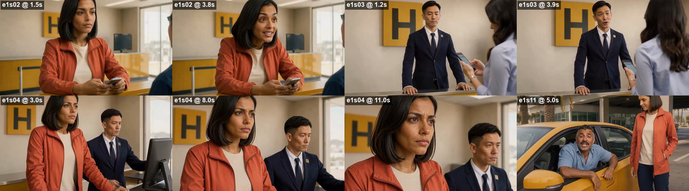

# Step 3 · Voices / 第 3 步 · 听声音

*23 Nov 2026 · The Rental Booking Paradox, episode 1*

## English

**What ran.** One clip for each voice, on the shot where that voice first speaks: e1s02 Traveler, e1s03 Clerk,
e1s04 the Narrator (off screen), e1s11 Driver. MiniMax H3 Fast (`nunchux-minimax-h3-fast-fl2va`), animating the
step 2 first frame, with the line and the room tone in the prompt. The clips are in
[assets/…/clips/draft/](../assets/the-rental-booking-paradox/clips/draft/).

**A slip.** The plan was to render these four at the final spec (768p, Radical Speed) so they could go straight into
the film. The code change for that did not land before the run (the file had to be read again before it could be
edited), so they rendered at the draft spec: 480p on Radical Value. They still did their job, but the final pass
renders these four again, about $0.31 more than planned. `voices --pass final` works now.

**Speed.** 64 s for the four, four at a time. Per call: 11.7 s for a 4.5 s clip, 38 s for 9.4 s, 62.7 s for 13.7 s.
Clips come back 864×480 at 24 fps, a little longer than asked (4.46 s for 4, 9.42 for 9, 13.67 for 13).

**Cost.** $0.54 by the account balance ($5.400 → $4.860), exactly the price list. (This note first said $0.31:
the balance had been read before every charge had posted.)

**What could be checked without ears.** Every clip has sound, and the speech sits where the line should:

| Shot | Voice | Speech found (s) | Reading |
|---|---|---|---|
| e1s02 | Traveler | 2.96–4.46 | quiet first, then the line, after the wrist-then-chin move the action asks for |
| e1s03 | Clerk | 2.46–2.75, 3.47–4.46 | "Sorry." a pause, then "We have no cars." |
| e1s04 | Narrator | 0.72–5.41, 6.08–12.72 | both sentences, with a pause between them, about 11 s |
| e1s11 | Driver | 0.39–8.46 with short breaths | about 7 s, both sentences |

In the frames, mouths move when their owner speaks. In e1s04, Traveler and the Clerk keep their mouths closed at 3,
8 and 11 s: the Narrator stays off screen, which was one of the two risks of this model.

**What went wrong.** In e1s03 an unknown woman, in a light blue shirt with long wavy hair and holding a phone, walked
into the Clerk's close-up. The action said "his eyes move from her phone screen back to her face", and H3 drew her.
Two fixes:
- e1s03 now reads "He is alone in the frame … toward the customer off-screen to the left".
- Every clip prompt now adds "Only the people already in Image 1 appear; no one else enters the frame." e1s06,
  e1s12 and e1s14 also mention someone off screen.

**Still open.**
- The voices themselves need human ears: whether each one fits its character, whether every word is there, the
  accent. The author is listening.
- Whether a voice holds from shot to shot cannot be judged from one line each. Traveler has four lines, Driver three,
  the Clerk and the Narrator two each; that is heard in the final pass. If a voice drifts, the fallback is H3's
  reference mode with that character's first line as `reference_audio` (it needs a public URL, which this repository
  can provide), or Grok Imagine 1.5 with voice references.

**Decided.** The final pass renders on Radical Speed at 768p, the author's call: about $3.36 by the price list,
probably less at the rate measured here. Balance now $5.09 of $6.00.

## 中文

**跑了什么。** 每个声音出一段，用它第一次开口的镜头：e1s02 旅客、e1s03 柜员、e1s04 旁白（画外音）、
e1s11 司机。模型是 MiniMax H3 Fast（`nunchux-minimax-h3-fast-fl2va`），用第 2 步的首帧做动画，台词和环境音
写在提示词里。片段在 [assets/…/clips/draft/](../assets/the-rental-booking-paradox/clips/draft/)。

**一个失误。** 原计划按终稿规格（768p、Radical Speed）出这 4 段，好直接放进成片。那处代码改动在开跑前没生效
（文件要先重新读取才能修改），所以实际按草稿规格出了：480p、Radical Value。这 4 段照样完成了听声音的任务，
但终稿时要重新出一遍，比计划多花约 $0.31。`voices --pass final` 现在已经能用了。

**速度。** 4 路并发，4 段共 64 秒。单次调用：4.5 秒的片段 11.7 秒，9.4 秒的 38 秒，13.7 秒的 62.7 秒。
返回的是 864×480、24 帧，时长比要求的略长（要 4 秒给 4.46，要 9 给 9.42，要 13 给 13.67）。

**花费。** 按账户余额实际 $0.54（$5.400 → $4.860），和价格页一致。（这份笔记最初写的是 $0.31：当时查余额太早，扣费还没全部入账。）

**不靠耳朵能检查的。** 每段都有声音，说话的位置和台词对得上：

| 镜头 | 声音 | 检测到说话的时间（秒） | 解读 |
|---|---|---|---|
| e1s02 | 旅客 | 2.96–4.46 | 先安静，做完"先推手腕、再抬下巴"的动作才开口 |
| e1s03 | 柜员 | 2.46–2.75、3.47–4.46 | "Sorry." 停顿，再 "We have no cars." |
| e1s04 | 旁白 | 0.72–5.41、6.08–12.72 | 两句都在，中间有停顿，约 11 秒 |
| e1s11 | 司机 | 0.39–8.46，中间有短暂换气 | 约 7 秒，两句都在 |

画面上，谁说话谁的嘴在动。e1s04 里旅客和柜员在第 3、8、11 秒都闭着嘴：旁白确实在画外。这是这个模型的两个风险之一，已经排除。

**出的问题。** e1s03 柜员的特写里走进来一个陌生女人：浅蓝衬衫、长卷发、手里拿着手机。原因是动作写的是
"他的目光从她的手机屏幕移回她脸上"，模型就把"她"画了出来。两处修复：
- e1s03 改成"他一个人在画面里……看向画面左侧外的顾客"。
- 所有片段的提示词都加上一句"只出现首帧里已有的人，没有人走进画面"。e1s06、e1s12、e1s14 的动作里也提到了画外的人。

**还没定的。**
- 声音本身要靠人耳判断：每个声音合不合人设、有没有吞字、口音如何。作者正在听。
- 同一个人的音色在不同镜头之间稳不稳，一人一句判断不了。旅客有 4 句，司机 3 句，柜员和旁白各 2 句，要到终稿才听得出来。
  如果漂了，后备方案是用 H3 的参考模式，把这个角色的第一句作为 `reference_audio`（需要一个公开链接，这个仓库就能提供），
  或者改用 Grok Imagine 1.5 的声音参考。

**已定的。** 终稿用 768p、Radical Speed，这是作者的决定。价格页估算约 $3.36，按这一步实测的单价可能更少。
当前余额 $6.00 里还剩 $5.09。
