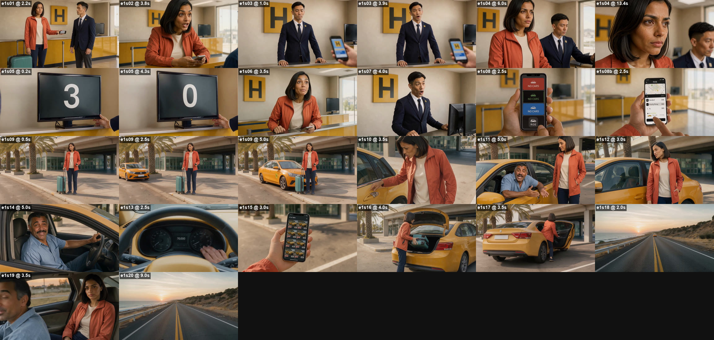

# Step 4 · Final pass

*23 Nov 2026 · The Rental Booking Paradox, episode 1, story v2*

## What ran

All 21 shots with MiniMax H3 Fast (`nunchux-minimax-h3-fast-fl2va`) at 768p on the Radical Speed tier, each from
its first frame (and last frame for e1s05 and e1s09), then ffmpeg assembly: title card, 21 clips with sentence-timed
subtitles, end card. The film runs 134.4 s at 1280×720; clips come back 1344×768 at 24 fps.

## What went wrong first

The first run rendered 4 clips and lost 17 within seconds, each to `400 engine_error: Generation failed`. The 4 that
worked were the shots redrawn in the last hour (e1s08, e1s08b, e1s09, e1s15); the 17 that failed started from
frames drawn about two hours earlier. Those frames' URLs, signed URLs returned by the image API, now answered 403.
The video endpoint could not read them and said only "Generation failed". Failed calls were not billed.

**Fix.** Frames for clips are now read from where the assets are published: this repository, through
`raw.githubusercontent.com`, the exact files that were reviewed. `make_film.py --frames-base <url>` checks that each
published file has the same size as the local one before it is sent. The second run rendered the other 17.

A small bug surfaced too: in `all`, a variable named `before` shadowed the balance read at the start, so the
closing balance check crashed after the run. Renamed.

## Speed

| | |
|---|---|
| Per clip | 3.5 to 12.3 s, median 4.4 s, for 4.5 to 13.7 s of 768p video with speech: faster than the clip plays |
| Second run, 17 clips, four at a time | 33.5 s of rendering, 51 s with assembly |
| Draft tier for comparison | 480p on Radical Value took 11.7 s for a 4.5 s clip and 62.7 s for 13.7 s |

## Cost

$3.57 for the 21 clips by the account balance, exactly the price list (119 s billed at $0.030). All in, from the first
reference sheet to the final cut: $4.97 of $6.00, $1.03 left.

## Checked

- The cast holds across all 21 clips: same faces, hair and outfits.
- e1s03: the Clerk is alone; the only thing entering the frame is her hand holding out the phone.
- e1s05: the monitor goes from 3 to 0. e1s09: the sedan drives in along the lane and stops at the curb in front of
  her. e1s08, e1s08b, e1s13 and e1s15: NO CARS, the RIDE screen, 70,000 and H Car Sales all read.
- Every line has speech where it belongs, including the two rewritten lines, e1s15's new line and the closing
  narration.

## Still open

- For the reviewer: e1s04's ending (the odd smile in the draft; not seen in the sampled frames), the crop for
  e1s19's missing seat, and whether each voice holds from shot to shot (Traveler speaks five times, the Driver three).
- $1.03 is enough to re-render about 34 s at this tier.

## Thinking at this point

- The image API's URLs are for downloading, not for referencing later. Anything a later call reads should live
  somewhere stable; this pipeline publishes assets first and renders from there.
- A generic error cost more time than the bug. "Generation failed" for an unreadable reference sent the diagnosis
  through timestamps; the pattern (only recent frames worked) is what gave it away.
- On the Radical Speed tier, clip time stops being the wait. Review, re-rolls and publishing are now the slow parts
  of making the film.
